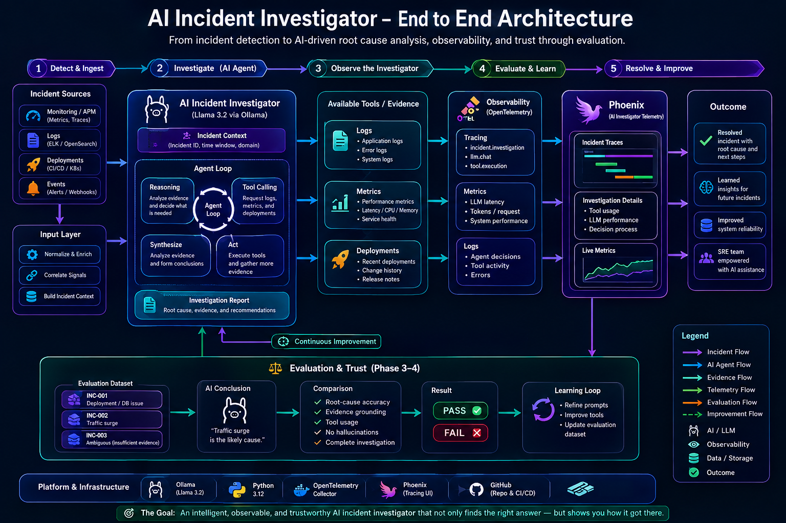

I wanted to build something that incorporated different technologies that are sometimes owned by different teams across an organization. The idea was to build an AI Incident Investigator in a controlled local environment that mimics an end-to-end, enterprise-level solution. A couple of weeks ago, an AI Infrastructure Leader talked to me about an open-source solution called Arize Phoenix, so I thought, why not try it out on my own with my own sample data? Before starting anything, I wanted to ensure I was also implementing other industry tools in the mix.

**The SRE incident investigation process:**

The Incident Investigator begins with a sample JSON file that contains information about the incident. It loads that incident into a Python application that takes the important information from the incident report and loads the LLM (Ollama Llama 3.2). During the JSON dump phase, it uses the incident deployment data, incident data, logs, and metrics telemetry to help perform a full analysis, create a root cause with evidence, and perform documentation. This is then pushed into the Phoenix backend, but in parallel, we are using OpenTelemetry to generate spans to gather the amount of time the LLM calls take. This helps us add an observability layer on the LLM and helps us understand the performance during the Agent investigation. This is then sent to Arize, which proceeds to visualize the telemetry and data from the incident and LLM calls and responds to the user with a full report in the terminal.




**Logs, Metrics, and Deployments:**

As separate sources, we created a JSON that contains logs, metrics, and deployment details for each incident. The agent calls these tools to gather incident information, begin analysis, and create an RCA and report with evidence and recommendations.
The get_error_logs() tool will gather the error evidence; get_service_metrics() also pulls the metrics, and the get_recent_deployment() tool retrieves the information about what was happening before the incident occurred. Having all three is important because each source gives the agent a different perspective of the problem. This allows us to correlate multiple evidence sources into an investigation and help produce a good RCA.


**Ollama + Llama 3.2:**

We chose to use the Ollama software to help us run the LLM locally and have our Python application communicate with Ollama by using the local API and Python library to support the tool calling. We have the Ollama software deployed in a Docker container and exposing port 11434.
We accompany the above software with the Llama 3.2 model because we wanted to make the project easier for anyone interested in cloning the repository to experiment with without requiring further authentication on other LLM flavors like OpenAI / Anthropic, etc. This model was appropriate for experimenting with the architecture without requiring a huge amount of infrastructure. Ollama’s documentation also states that the 3B version is for instruction following, summarization, prompt rewriting, and tool use. Llama 3.2 gives us a lightweight model that can use tool-calling capabilities and perform well as an AI-powered investigation Agent


**Tool Calling & The investigation loop:**

The investigation loop that goes through the tool calls allows the agent to go beyond just reading an incident and generating a response. The investigation begins with Llama 3.2 being provided the incident with a set of available tools that represent telemetry and info from different sources of operational evidence. The LLM then decides what evidence is required and starts the tool calling. The Python application receives the request and executes the tool, which then returns the resulting evidence to the LLM. Once the model evaluates the evidence, it proceeds to do another tool call if it needs additional information until it has enough data to create a good conclusion. In an enterprise production environment, these same tools could eventually pull data from other systems like Prometheus, Kubernetes, Kafka, and other infrastructure layers rather than the synthetic JSON files we are using for this project.

**Producing the final investigation report:**

Once the entire investigation loop completes, the agent will produce a report. The Agent will stop requesting additional data and provide an organized incident analysis. Below is an example of the sources it pulls from and the report it generates:

**Sources:**

**Deployment::**

```json
{
  "service": "checkout-api",
  "deployments": [
    {
      "deployment_id": "DEP-8465",
      "deployment_time": "09:30",
      "version": "2026.08.07.2",
      "changes": [
        "Routine dependency updates"
      ]
    }
  ]
}
```

**Incident:**

```json
{
  "incident_id": "INC-002",
  "title": "HTTP 5xx spike",
  "severity": "SEV-2",
  "description": "A sudden increase in incoming traffic caused elevated API latency and a spike in HTTP 5xx responses.",
  "symptoms": [
    "HTTP 5xx errors increased",
    "CPU utilization increased significantly",
    "Database connections remain within normal limits",
    "No deployment occurred immediately before the incident"
  ],
  "timeline": [
    "14:00 - Normal traffic around 1,000 requests/minute",
    "14:05 - Traffic begins increasing",
    "14:10 - Traffic reaches approximately 8,000 requests/minute",
    "14:12 - API latency begins increasing",
    "14:15 - HTTP 5xx errors increase"
  ]
}
```

**Logs:**

```json
{
  "service": "checkout-api",
  "time_window": "14:00-14:20",
  "entries": [
    {
      "timestamp": "14:12",
      "level": "ERROR",
      "message": "Request processing timeout"
    },
    {
      "timestamp": "14:13",
      "level": "ERROR",
      "message": "HTTP 500 returned to client"
    },
    {
      "timestamp": "14:15",
      "level": "ERROR",
      "message": "HTTP 503 returned to client"
    },
    {
      "timestamp": "14:16",
      "level": "ERROR",
      "message": "Request queue depth exceeded threshold"
    }
  ]
}

```

**Metrics:**

```json
{
  "service": "checkout-api",
  "time_window": "14:00-14:20",
  "metrics": [
    {
      "timestamp": "14:00",
      "latency_ms": 200,
      "cpu_percent": 42,
      "database_connections": 32,
      "requests_per_minute": 1000
    },
    {
      "timestamp": "14:10",
      "latency_ms": 350,
      "cpu_percent": 68,
      "database_connections": 38,
      "requests_per_minute": 8000
    },
    {
      "timestamp": "14:15",
      "latency_ms": 4200,
      "cpu_percent": 91,
      "database_connections": 41,
      "requests_per_minute": 8200
    }
  ]
}
```

**Llama 3.2 - Final Report:**

Investigating: INC-002
Title: HTTP 5xx spike


Investigation Report:

**Summary**

A sudden increase in incoming traffic caused elevated API latency and a spike in HTTP 5xx responses, resulting in an SEV-2 incident (INC-002).

**Most Likely Root Cause**

The most likely root cause is that the increased traffic exceeded the API service's capacity, leading to request processing timeouts, HTTP 500 and 503 errors, and elevated CPU utilization. The sudden increase in traffic, combined with the absence of recent deployments, suggests a possible issue with the service's scalability or capacity planning.

**Evidence Supporting the Hypothesis**

* The significant increase in requests per minute (from 1000 to 8200) indicates that the API service was unable to handle the increased load.
* The elevated CPU utilization and latency suggest that the service's resources were overwhelmed.
* The presence of error logs indicating request processing timeouts, HTTP 500 and 503 errors, and a request queue depth exceeded threshold further supports this hypothesis.

**Alternative Hypotheses**

While the most likely root cause is that the increased traffic exceeded the API service's capacity, alternative hypotheses could include:
* A configuration issue or bug in the API service
* An external factor affecting the API service's performance (e.g., network congestion, third-party service issues)
* Human error or misconfiguration

**Recommended Next Steps**

1. Investigate the API service's scalability and capacity planning to determine if there were any issues with handling increased traffic.
2. Review recent configuration changes and logs to identify any potential causes of the issue.
3. Verify that all external dependencies are functioning correctly and not contributing to the issue.
4. Consider conducting further testing and stress load simulations to validate the API service's performance under similar conditions.

Please let me know if you would like me to expand on this or provide further clarification!


**What's Next:**


