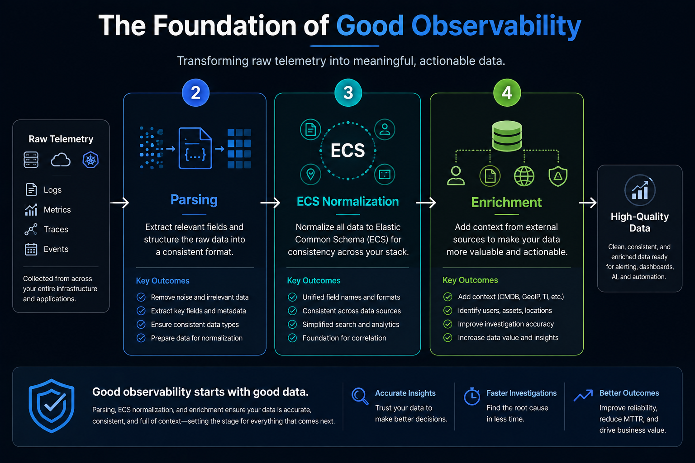

Data is usually ingested into a backend in a raw format. This slows down the process of searching and analyzing the data to gather the information your team is looking for. If you want your Observability to be top-notch, you need to first collect your data from the whole infrastructure stack and begin normalizing and enriching the telemetry that you are collecting. Just collecting the data is not enough, and if cleaning the data is not prioritized in the process, it can lead to many struggles down the road when trying to use other features for intelligent analysis. Full-stack observability is a huge project that can take time and alignment at an enterprise level. However, let's dive into a smaller scope where we can see why good observability/monitoring begins with clean data. Many teams are interested in Alerts, so let's dive into this small example




Example:
In our first simple example, we will look at capturing a high CPU of a virtual machine. Within the Raw Data, we have the following:
```json
{
“host”: “srv001”,
“cpu”: 85
}
```
When you configure the alert, you set the rule to trigger an Alert Notification if above 80%.

The issue with this afterward is that the users or operators may get the alert, and the following questions are:
- Did it come from a production or lower environment server?
- What application did this alert come from?
- Who owns this server?
- How long has it surpassed the threshold?

Now imagine having many alerts set up with little to no context. This can create alert fatigue, false positives, and noisy alerts, leading to longer MTTR.

The right approach for a good Alert is to have appropriate naming conventions that are followed across the stacks and tools. Additionally, configure the alert with more information about that stream of data.

**The correct approach:**

Take a larger set of information that provides some context on the name, the CPU percentage, environment, application name, owner, service tier, and cloud region, as an example below:
```json
{
"host.name": "srv01",
"host.cpu.pct": 0.95,
"environment": "prod",
"application": "payments-api",
"owner_team": "Digital Payments",
"service_tier": "critical",
"cloud.region": "us-east-1"
}
```
Once you gather the data types that will give the users/team more context, we can proceed with configuring the alert that informs the CPU has been breached AND which environment AND whether it's critical AND for how long the breach occurred. This creates an alert that is actionable. We can see that using good data can create good observability in a small example, and if this was replicated in many other features and areas in the process to get end-to-end full stack observability, then you will get great insights.
Now let's pivot to another issue that occurs before any alert can be configured. The problem of having logs not enriched and cleaned for proper Alerting. Sometimes we need to parse data to get the necessary information to not only monitor but reach true Observability and correlations down the road.

Let's suppose your application writes the following log:

- Payment failed for customer=12345
- TransactionID=ABC123
- ErrorCode=504
- Region=US
- Amount=2500
```json
{
"message": "Payment failed for customer=12345 TransactionID=ABC123 ErrorCode=504 Region=US Amount=2500"
}
```
When the log message is received in this packaged way, there are details buried inside the text that are important for teams requiring alerts on specific data types. When we want good observability, we need to ensure we dissect the log message by parsing it. Utilizing a pipeline on Elastic, we can parse the message every time a document shows up. In Elasticsearch, you have 3 processor options that can be used. The GROK processor is great for handling a variety of formats being ingested and is really good for complex logs. It also uses Regex and has a higher level of complexity than the other 2. The major downside is that it can create slow performance, and CPU can be heavily impacted, which can create cluster issues in the future. The KV processor is much faster with a simple level of complexity. This is a friendlier option because there is no need for regex, and it has a low impact on CPU. One thing to consider is that it's best for when there are key=value logs in the message. Lastly, the Dissect processor is the fastest with a simple level of complexity and does not use regex. This is a friendlier option, but it handles limited formats, and it's best for fixed-position logs, ensuring low CPU impact.

The 3 options really depend on the use case of the logs and how the log messages are ingested consistently over time. The questions that teams should also ask themselves to ensure good observability are “What will I alert on from within the message?” and “Will this data be useful later?”

**Multiple examples below:**

**Grok Processor:**
```json
PUT _ingest/pipeline/payment_log_pipeline
{
"description": "Parse payment failure logs",
"processors": [
{
"grok": {
"field": "message",
"patterns": [
"Payment failed for customer=%{NUMBER:customer_id} TransactionID=%{WORD:transaction_id} ErrorCode=%{NUMBER:error_code} Region=%{WORD:region} Amount=%{NUMBER:amount:int}"
]
}
}
]
}
```
After grok ingestion:
```json
{
"customer_id": "12345",
"transaction_id": "ABC123",
"error_code": "504",
"region": "US",
"amount": 2500
}
```

**KV Processor:**
```json
PUT _ingest/pipeline/payment_log_pipeline
{
"processors": [
{
"kv": {
"field": "message",
"field_split": " ",
"value_split": "="
}
}
]
}
```
After KV Processor:
```json
{
"customer": "12345",
"TransactionID": "ABC123",
"ErrorCode": "504",
"Region": "US",
"Amount": "2500"
}
```


**Dissect Processor:**
```json
PUT _ingest/pipeline/payment_dissect_pipeline
{
"processors": [
{
"dissect": {
"field": "message",
"pattern": "Payment failed for customer=%{customer_id} TransactionID=%{transaction_id} ErrorCode=%{error_code} Region=%{region} Amount=%{amount}"
}
}
]
}
```
After Dissect Processor:
```json
{
"customer_id": "12345",
"transaction_id": "ABC123",
"error_code": "504",
"region": "US",
"amount": "2500"
}
```
Once you have decided your parsing strategy, part of the process to perform good observability is making the ECS Mapping or Elastic Common Schema. This is where your data types have the best standard naming to have full integration with other features within Kibana like dashboards, queries, alerts, AI Agent, and further correlations.

This is a step that can be overlooked because teams may be more concerned with ingestion of the data. This step is important because the ECS values give teams and organizations data from different sources a consistent pattern in their data type names. If 2 or 3 teams are sending the user ID into the backend, you would want that name to be the same across the platform. If they send different names, it will create complexity when setting up alerts, dashboards, workflows, or prompting AI. Standardizing this data type will make configuring other features much easier and integrate seamlessly with additional features.

**Lessons Learned:**

I personally have learned this through trial and error. If you are planning on having good observability across the board, it's important to take these topics into consideration and prioritize them at the correct time. The worst thing is having to go back to standardize data types across infrastructure when you already have features like alerts, dashboards, ML jobs set up and tied to certain naming conventions or having multiple data type names equaling the same keyword.
